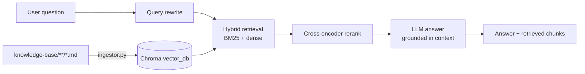

# Exercise 05: RAG Knowledge Worker 🧠

A question-answering assistant over a knowledge base, built as a full Retrieval-Augmented Generation (RAG) pipeline: Markdown 
ingestion, hybrid retrieval (BM25 + dense) with cross-encoder reranking, conversational query rewriting, 
and grounded answer generation through LiteLLM. It ships with a Gradio chat app and an evaluator Gradio app, 
for scoring the pipeline against a 165-question test set and comparing runs side by side.

The knowledge base is synthetic data about a fictional insurance company, **Insurellm** (company info, contracts, employees, products).

---

## 🏗️ Technical Architecture



The project is split into three layers:

* **Ingestion (`ingestor.py`):** Loads every `.md` file under `knowledge-base/`, tagging each document with a `doc_type` taken from 
its subfolder name. Documents are split with LangChain's `MarkdownTextSplitter` into **450-token chunks with 100-token overlap**, 
where length is measured with the *embedding model's own tokenizer* rather than characters. Chunks are embedded with a 
Hugging Face model (normalized embeddings) and persisted to Chroma, along with a `manifest.json` recording which embedding 
model built the store. Re-running the ingestor safely wipes and rebuilds the store.
* **RAG core (`rag/` package):**
  * **`factory.py`:** Loads `active_config.json` (falling back to defaults), loads the Chroma store through an LRU cache, 
  **verifies the embedding model matches the one in the manifest** (a mismatch raises an error), and rebuilds the chunk 
  list that BM25 needs.
  * **`retriever.py`:** Builds the retrieval pipeline. Either dense-only, or an `EnsembleRetriever` fusing BM25 and dense results 
  (50/50 weights, Reciprocal Rank Fusion), optionally followed by a `CrossEncoderReranker` that narrows `candidate_k`
  candidates down to `final_k`.
  * **`answer.py`:** Runs one turn end to end: **rewrite → retrieve → generate**. Every LLM call goes through LiteLLM with 
  retries and is timed, token-counted and cost-tracked in a `CallLog`. The generation prompt forces short, direct answers 
  from the retrieved context only, and a fixed abstention phrase when the context doesn't contain the answer.
  * **`questions_loader.py`:** Loads and validates the JSONL test set with a Pydantic schema, reporting the exact line number
  of any malformed entry.
* **Apps & evaluation:**
  * **`chat.py`:** The Gradio chat UI. A side panel shows the exact chunks retrieved for the latest answer, which is handy for 
  debugging.
  * **`rag/evaluator.py`:** The evaluation engine and a command-line runner.
  * **`evaluator_UI.py`:** The Gradio "RAG Pipeline Lab" built on top of the evaluator.

### Project layout

```
05-rag-assistant/
├── chat.py                # Gradio chat app
├── evaluator_UI.py        # Gradio evaluation lab
├── ingestor.py            # Builds the vector store
├── active_config.json     # Runtime retrieval settings used by the chat app
├── knowledge-base/        # Markdown source documents (subfolder = doc_type)
│   ├── company/
│   ├── contracts/
│   ├── employees/
│   └── products/
├── vector_db/             # Chroma store + manifest.json (generated)
├── runs/                  # Saved full-pipeline evaluation runs (generated)
├── retrieval_runs/        # Saved retrieval-only runs (generated)
└── rag/
    ├── __init__.py
    ├── answer.py
    ├── evaluator.py
    ├── factory.py
    ├── logging_config.py
    ├── questions_loader.py
    ├── retriever.py
    └── tests.jsonl        # 165 evaluation questions
```

---

## 🚀 How to Run It

Ensure you have synchronized the root environment via `uv sync` from the main project root folder first.

#### 📦 Core Libraries Used
*   **`langchain-core`, `-community`, `-classic`, `-chroma`, `-huggingface`, `-text-splitters`**: Document loading, 
Markdown-aware chunking, BM25 and dense retrievers, ensemble fusion and contextual compression.
*   **`chromadb`**: Local persistent vector store.
*   **`rank-bm25`**: The BM25 algorithm behind the sparse half of hybrid retrieval.
*   **`sentence-transformers`**: Runs the embedding model and the cross-encoder reranker locally.
*   **`transformers`**: Supplies the tokenizer used to measure chunk size in tokens.
*   **`torch`**: Backend tensor library for the embedding and reranker models; used with a CUDA build if available.
*   **`litellm`**: One interface for the rewrite, generation and judge models, whether local (Ollama) or cloud.
*   **`pydantic`**: Validates test questions and enforces the judge's structured output.
*   **`gradio`** and **`pandas`**: The chat UI and the evaluation lab.
*   **`python-dotenv`**: Loads environment variables from a local `.env` file.

#### ⚙️ Configuration
Models are configured through environment variables. Retrieval behavior lives in `active_config.json`.

| Setting                   | Env Var               | Default                                  |
|---------------------------|-----------------------|------------------------------------------|
| Embedding model           | `EMBEDDING_MODEL`     | `BAAI/bge-small-en-v1.5`                 |
| Cross-encoder reranker    | `CROSS_ENCODER_MODEL` | `BAAI/bge-reranker-v2-m3`                |
| Generation model (LiteLLM)| `GENERATION_MODEL`    | `ollama_chat/qwen3.5:4b`                 |
| Query-rewrite model       | `REWRITE_MODEL`       | `ollama_chat/qwen3.5:4b`                 |
| LLM judge model           | `JUDGE_MODEL`         | `gemini/gemini-3.5-flash-lite`           |
| Log level                 | `LOG_LEVEL`           | `INFO`                                   |

If you use a cloud model (the judge defaults to Gemini), also set that provider's API key in `.env` using the variable name 
LiteLLM expects, e.g. `GEMINI_API_KEY`.

`active_config.json` controls retrieval for the chat app:

| Key               | Meaning                                                       | Default         |
|-------------------|---------------------------------------------------------------|-----------------|
| `use_hybrid`      | Combine BM25 with dense retrieval (`false` = dense only)      | `true`          |
| `rerank_method`   | `cross_encoder` or `none` (truncate to `final_k`)             | `cross_encoder` |
| `rewrite_enabled` | Rewrite follow-up questions into standalone queries           | `true`          |
| `candidate_k`     | Candidates fetched by each retriever before reranking         | `20`            |
| `final_k`         | Chunks passed to the LLM                                      | `10`            |

> The embedding model is baked into the vector store. If you change `EMBEDDING_MODEL`, re-run the ingestor, otherwise the app will 
refuse to start with an "Embedding model mismatch" error.

### 1. Set up your LLM backend
**Using local Ollama (the defaults):** make sure your instance is active and the model is downloaded:
```bash
ollama pull qwen3.5:4b
```
**Using a cloud provider instead:** set `GENERATION_MODEL` / `REWRITE_MODEL` to a LiteLLM model name 
(for example `gemini/...` or `openai/...`) and provide the matching API key in `.env`.

The judge model is only used for evaluation, not for chatting.

### 2. Build the vector store
Run the ingestor once (and again whenever the knowledge base or embedding model changes). The first run downloads the embedding 
model from Hugging Face:
```bash
uv run exercises/05-rag-assistant/ingestor.py
```
Optional flags: `--source` (knowledge-base folder) and `--persist` (where to write the Chroma store).

### 3. Launch the chat app
```bash
uv run exercises/05-rag-assistant/chat.py
```
It starts a local Gradio server and opens a browser tab. Ask a question about Insurellm; the right-hand panel shows the ranked 
chunks that were retrieved for the last answer. Model-server, rate-limit and model-not-found errors are surfaced as readable 
in-UI messages.

### 4. Launch the evaluation lab
```bash
uv run exercises/05-rag-assistant/evaluator_UI.py
```

---

## 📊 Evaluation

### Test set
`rag/tests.jsonl` contains **165 questions**: 150 taken from Ed Donner's 
[llm_engineering](https://github.com/ed-donner/llm_engineering/tree/main/week5/evaluation) repository, plus **15 unanswerable 
questions that I added** as an extra category to check that the system declines instead of hallucinating. Each line looks like this:

```json
{"question": "When was Insurellm founded?", "keywords": ["2015", "founded"], "reference_answer": "Insurellm was founded in 2015.", "category": "direct_fact", "answerable": true}
```

Questions are grouped by category (e.g. `direct_fact`, `temporal`, `comparative`, `numerical`, `relationship`, `spanning`, 
`holistic`, and the added `unanswerable`) so you can see *which kinds* of questions a configuration is good or bad at.

### Metrics
Two complementary layers are measured for every question:

**Retrieval (no LLM needed)**, checking whether each question's `keywords` appear in the retrieved chunks (case-insensitive, 
whole-token match):
* **MRR:** average over keywords of `1 / rank` of the first chunk containing the keyword. Rewards putting the evidence at the top.
* **nDCG:** the same idea with a rank discount over the top `final_k` chunks.
* **Keyword coverage:** the percentage of keywords found anywhere in the retrieved chunks.

**Answer quality (LLM-as-judge)**, where the judge compares the answer to the reference and returns structured scores:
* **Accuracy, Completeness, Relevance:** each 1–5. For unanswerable questions, a correct refusal scores accuracy 5 
and leaves the other two empty, while a fabricated answer scores 1 across the board.
* **Abstention rate:** the percentage of unanswerable questions the system correctly declined.
* **Cost of the run:** average seconds and tokens per question.

Because retrieval is scored by keyword matching, treat MRR/nDCG/coverage as a fast *proxy* for retrieval quality rather 
than a perfect measure.

> During evaluation, query rewriting is always disabled, because every test question is already standalone.

### RAG Pipeline Lab (`evaluator_UI.py`)
Four tabs:

| Tab                        | What it does                                                                                                                                                                                                                                                        |
|----------------------------|---------------------------------------------------------------------------------------------------------------------------------------------------------------------------------------------------------------------------------------------------------------------|
| **Full Run**               | Runs the whole pipeline plus the judge. Toggle hybrid retrieval, reranker and `final_k`; limit the number of questions; set a random seed; use up to 4 concurrent workers. Shows colour-coded metric cards, an accuracy-by-category chart and a per-category table. |
| **Retrieval Check**        | Retrieval + keyword scoring only. No judge calls, so it is fast and free. Good for tuning retrieval before spending judge budget.                                                                                                                                   |
| **Compare Full Runs**      | Pick two saved runs (A and B) and see overall and per-category deltas (B − A).                                                                                                                                                                                      |
| **Compare Retrieval Runs** | Same comparison for retrieval-only runs.                                                                                                                                                                                                                            |

Every run is saved as a timestamped JSON file (in `runs/` or `retrieval_runs/`) containing the config, sampling settings, 
model names, the aggregated summary and every individual evaluation, so any two configurations can be compared later. 
Sampling is **seeded** (default `42`), so the same limit and seed always select the same questions, which keeps comparisons fair. 
The compare tabs warn you if two runs used different sampling.

### Command-line evaluation
A full evaluation can also be run without the UI. The `rag` package uses relative imports, so run it as a module from inside the 
project folder:
```bash
cd exercises/05-rag-assistant
uv run python -m rag.evaluator --tests-limit 30 --max-workers 1
```
Useful flags: `--use-hybrid` / `--no-use-hybrid`, `--rerank-method {none,cross_encoder}`, `--seed`, `--tests`, `--persist`, 
`--runs`, `--configs`. A summary table is printed and the run is saved to `runs/`.

### Results

#### Retrieval quality (retrieval-only runs, 165 questions, `final_k = 10`)

| Configuration                     | MRR        | nDCG       | Keyword coverage |
|-----------------------------------|------------|------------|------------------|
| Dense only, no rerank             | 0.8739     | 0.8629     | 96.8%            |
| Dense only + cross-encoder        | 0.9463     | 0.9128     | 98.0%            |
| Hybrid (BM25 + dense), no rerank  | 0.9163     | 0.8882     | 97.9%            |
| **Hybrid + cross-encoder (default)** | **0.9536** | **0.9166** | **98.2%**        |

What the numbers show:
* **The cross-encoder is the biggest single improvement.** It lifts MRR by about +0.07 on dense retrieval and +0.04 on 
hybrid retrieval.
* **Hybrid retrieval helps most when there is no reranker** (MRR +0.04 over dense only). Once the cross-encoder is on, 
the extra gain from BM25 shrinks to under +0.01 MRR, which is small enough that it may not be significant on a keyword-based proxy.
* **Keyword coverage barely moves** (96.8% to 98.2% across all four setups). The needed evidence is almost always somewhere in 
the top 10, so most of the gain comes from *ordering* it better, not from finding more of it.

---

## ⚠️ Notes

* **Local models:** the embedding model and cross-encoder run on your machine and are downloaded from Hugging Face on first use. 
A GPU helps but isn't required.
* **Rate limits:** free-tier cloud APIs limit requests per minute rather than per connection, so raising the number of concurrent 
workers only speeds up evaluation up to a point.
* **Small local models:** the defaults (a 4B-parameter model) favor running anywhere over answer quality. Swapping `GENERATION_MODEL` 
for a stronger model is the easiest way to raise accuracy.

---

## 📚 Credits & License

The knowledge base (the fictional Insurellm documents) and the original 150 test questions come from 
[Ed Donner's `llm_engineering` repository](https://github.com/ed-donner/llm_engineering/tree/main/week5). 
That repository is licensed under the **MIT License**; its copyright and license notice are reproduced in [THIRD_PARTY_LICENSE.txt](THIRD_PARTY_LICENSE.txt). 
The 15 unanswerable questions, and all pipeline and evaluation code in this exercise, are my own additions.